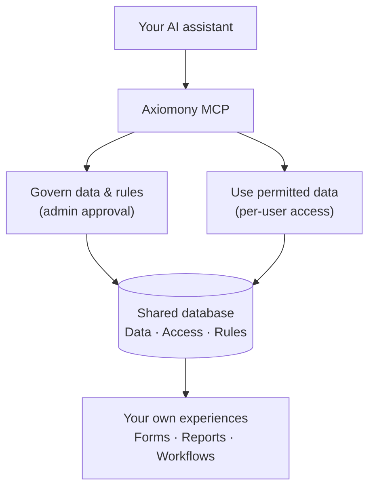

<div align="center">
  
  <br>
  

  <p><strong>Shared rules. Individual freedom.</strong></p>

  <p>
    <a href="https://sjoerdvanderhoorn.github.io/axiomony/">Introduction</a> ·
    <a href="https://sjoerdvanderhoorn.github.io/axiomony/getting-started.html">Installation</a> ·
    <a href="https://sjoerdvanderhoorn.github.io/axiomony/connect.html">Connect an AI</a> ·
    <a href="https://sjoerdvanderhoorn.github.io/axiomony/tools.html">MCP tools</a> ·
    <a href="ROADMAP.md">Roadmap</a>
  </p>
</div>

# Axiomony

**An AI-accessible interface to a shared business database.** Define data structures, access permissions and business rules at the source, then let each person or team build the tools and user experience that suit their work.

> Up until now, AI has been very good at making tools for individuals that however don't adapt well to business processes. It has also been very good at assisting developers building software, which by the nature of generalization, does not adapt very well to individual use cases. Axiomony brings AI to a new level by giving individual users freedom to create their own apps that then securely connect to a database that represents the rules and flows of the shared business processes.

## The concept

Conventional software separates the database, backend and user interface, often embedding business rules in code written for one particular application. Schema-first tools and low-code systems can reduce development effort, but teams still inherit a vendor's choices about screens, workflows and integrations.

Axiomony separates **the shared rules of the organization** from **the individual experience of working within them**.

- **Define the business model with AI.** Describe tables, relationships, permissions and business rules in natural language. An authorized administrator reviews and approves the proposed database changes.
- **Enforce rules in the database.** Permissions, constraints and policies apply regardless of which application accesses the data. There is no separate, competing application-specific rules engine.
- **Give people their own interface.** Purchasing may use a mobile invoice form; Sales may want a pipeline view; Finance may prefer a reconciliation dashboard. All use the same governed data.
- **Keep ordinary tools predictable.** A dedicated Data MCP exposes fixed read/write operations using each authenticated database user's own privileges.

**Standardize the data and the rules, not the user interface.**

## A minute with ACME

In this one-minute concept demo, an ACME administrator uses ChatGPT to define accounting data, purchasing and sales workflows, permissions and business rules, ending with a simplified ERD. Next, Purchasing builds a mobile invoice app in Claude, Sales builds a quotation tool in Gemini, and Finance creates a review dashboard in ChatGPT. Each experience uses the same governed database.


[Watch or download the 60-second MP4 demo](docs/assets/acme-software-demo.mp4)

*Concept animation, not a live application recording. Independently hosted browser apps still need an authenticated runtime to access Data MCP securely.*

## How Axiomony works



The Axiomony server exposes two complementary MCP interfaces:

| Interface | Responsibility |
| --- | --- |
| **Administration MCP** | An internal AI planner prepares changes to actual database schema, privileges and rules. Administrators review the plan and explicitly approve execution. |
| **Data MCP** | Users and their trusted applications discover accessible tables and read or modify records. The database rechecks their effective privileges and rules on every operation. |

**No additional middleware is needed to own or duplicate the organization's business rules.** The MCP server remains the transport and management interface; the database is the source of truth. Browser-based apps still need a trusted, authenticated runtime to call Data MCP safely without embedding passwords in frontend JavaScript. That browser bridge is not currently included.

**Technical implementation:** Node.js, Streamable HTTP MCP, and PostgreSQL. The current database uses native grants, row-level security, constraints and triggers. [Architecture and security details](https://sjoerdvanderhoorn.github.io/axiomony/concepts.html).

## Installation

Axiomony supports two Docker deployment modes:

| Mode | Included services |
| --- | --- |
| **Standalone** | MCP server, REST server, database and static HTTP server |
| **External Database** | MCP and REST servers connected to an existing database |

Both modes are configured through `.env` and require strong, unique REST credentials. Standalone also requires an operator-chosen bootstrap database password. No default administrator password is provided.

```sh
git clone https://github.com/sjoerdvanderhoorn/axiomony.git
cd axiomony
cp .env.example .env
# Edit .env: set PGDATABASE, REST_AUTH_PASSWORD, REST_JWT_SECRET,
# and POSTGRES_BOOTSTRAP_PASSWORD for Standalone.
```

**Standalone:**

```sh
docker compose -f compose.yml -f compose.standalone.yml up -d --build
```

**External Database** (configure connection details and initialize the restricted REST authenticator on your own database first):

```sh
docker compose up -d --build
```

Check the service:

```sh
curl http://127.0.0.1:3000/health
```

The MCP endpoint is `http://127.0.0.1:3000/mcp`. The REST compatibility endpoint is `http://127.0.0.1:3001/`. Standalone also serves user-published static files locally on port `8088`.

See the [installation guide](https://sjoerdvanderhoorn.github.io/axiomony/getting-started.html) for environment variables, passwords, external database setup, and credential rotation. Changing a bootstrap secret in `.env` does not update an existing database volume's stored password.

## MCP tools

The tools visible to each account depend on its actual database permissions and the chosen deployment mode. Core categories include:

- **Discovery & explanations:** `whoami`, `list_tables`, `describe_table`, `explain_permissions`, `app_integration_guide`.
- **Data operations:** `select_records`, `insert_record`, `update_records`, `delete_records`.
- **Administration:** `inspect_database`, `manage_database`, `review_plan`, `implement_plan`, `cancel_plan`.
- **Static publishing (Standalone):** `site_list`, `site_read_file`, `site_create_file`, `site_update_file`, `site_delete_file`, `site_delete_project`.
- **Optional compatibility REST helpers:** `rest_api_guide`, `rest_relationships`, `generate_rest_request` (only when `REST_MCP_TOOLS=true`).

The database, rather than the presence of a tool in an AI client, determines which operations an account is authorized to perform. Read the [complete tool reference](https://sjoerdvanderhoorn.github.io/axiomony/tools.html) and [connection guide](https://sjoerdvanderhoorn.github.io/axiomony/connect.html).

## Security considerations

- **Permissions are database-enforced.** Applications cannot simply assign themselves more access than their authenticated database principal has. Stolen credentials and unsafe third-party integrations remain risks.
- **The current MCP endpoint uses HTTP Basic with reusable database credentials.** Keep the service on a trusted local network; do not expose it directly to the internet. Publicly accessible deployments require a suitable authentication and session design.
- **Browser apps need a trusted runtime.** Never place database passwords or API secrets in user-generated HTML or JavaScript. Static hosting does not provide authenticated data sessions.
- **Administrative SQL requires review.** AI-generated migration plans are inspected and explicitly approved by an authorized administrator before execution; the planner and validator do not substitute for independent security review.

See [architecture and security](https://sjoerdvanderhoorn.github.io/axiomony/concepts.html#security) and the [roadmap](ROADMAP.md) for current capabilities and planned improvements.

## Development

Node.js 22+ is required when running locally without Docker:

```sh
npm install
npm test
```

Tests cover the Node.js behavior and Compose configuration, but do not establish end-to-end correctness across a running database, all containers and hosted AI clients. Please use [GitHub issues](https://github.com/sjoerdvanderhoorn/axiomony/issues) for feedback and proposals.

---

**Axiomony — Shared rules. Individual freedom.**
