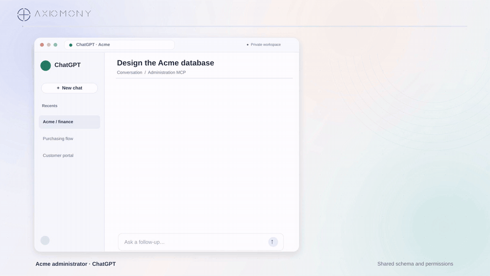
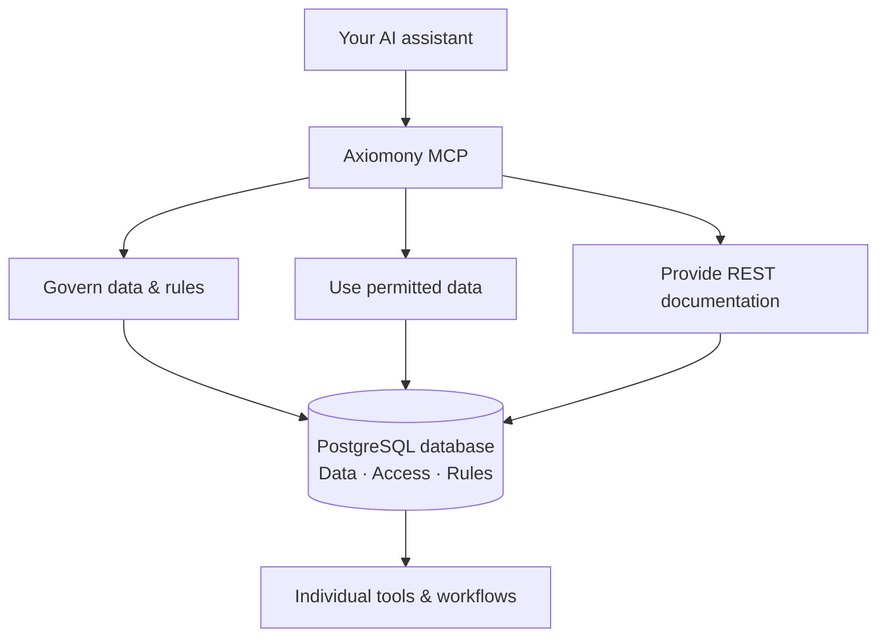

<div align="center">
  
  <br>
  
  <p><strong>Shared rules. Individual freedom.</strong></p>
  <p><a href="https://sjoerdvanderhoorn.github.io/axiomony/">Introduction</a> · <a href="https://sjoerdvanderhoorn.github.io/axiomony/getting-started.html">Installation</a> · <a href="https://sjoerdvanderhoorn.github.io/axiomony/connect.html">Connect an AI</a> · <a href="https://sjoerdvanderhoorn.github.io/axiomony/tools.html">MCP tools</a></p>
</div>

# Axiomony

**An MCP server for PostgreSQL that lets AI assistants set up a shared business database and help people create their own tools.** The database—not a custom application backend—enforces permissions and business rules.

> Up until now, AI has been very good at making tools for individuals that however don't adapt well to business processes. It has also been very good at assisting developers building software, which by the nature of generalization, does not adapt very well to individual use cases. Axiomony brings AI to a new level by giving individual users freedom to create their own apps that then securely connect to a database that represents the rules and flows of the shared business processes.

**Axiomony points to the next evolution of AI:** agents that help everyone work with shared business data through their own applications, making much of traditional custom software development unnecessary.

## The concept

Instead of commissioning one large application for everyone, start by telling an AI assistant how your organization works. Through Axiomony, an administrator can define the tables, relationships, access rights, and rules in **PostgreSQL**. The administrator reviews proposed changes before they are applied.

**No second set of business rules needs to be maintained in application middleware.**

After that, each person can ask ChatGPT, Claude, Gemini, or another compatible AI assistant to create a tool that fits their job. They can work with their data through Axiomony's **Data MCP**, or build an application using **REST documentation** and the included REST server. Both routes rely on the same database permissions and rules.

## Example

Imagine **Acme**, a company that buys and sells products and needs to keep its accounts in order. Its administrator opens ChatGPT and explains the business: customers place orders, Purchasing processes supplier invoices, Sales sends quotes, and Finance handles payments. ChatGPT uses Axiomony to propose the database tables, how they relate, who can view or change records, and when an invoice needs approval. Once the administrator accepts the plan, the shared database is ready.

Now the employees take over. Someone in **Purchasing** opens Claude on their phone and asks for an app that scans supplier invoices and sends them for approval. A **Sales** colleague uses Gemini to create a laptop-friendly quotation tool that turns accepted quotes into orders. Meanwhile, **Finance** uses ChatGPT to create a dashboard for invoices, approvals, and bank reconciliation.

They all get different interfaces—without having to build three different business backends. Their tools use the same PostgreSQL data, permissions, and workflows.

<p align="center">
  
</p>

<p align="center"><sub>Illustrative one-minute concept animation · Rendered from editable JavaScript, 1920 × 1080 at 30 fps.</sub></p>

<p align="center"><a href="https://sjoerdvanderhoorn.github.io/axiomony/acme-demo.html">Explore the interactive demo</a> · <a href="demo/acme/README.md">Edit the animation and render a new video</a></p>

## How Axiomony works



Axiomony exposes database management and data tools through **MCP**. It can also describe the REST API, so an AI agent can build an app that communicates with PostgreSQL **through PostgREST** rather than making every data request through the MCP server. REST requests still use PostgreSQL roles and policies. REST documentation tools are enabled with `REST_MCP_TOOLS=true`.

## Installation

**PostgreSQL is required.** Choose one of two Docker configurations:

| Option | Includes |
| --- | --- |
| **Standalone** | MCP server, REST server, PostgreSQL, and a static HTTP server. The easiest way to start. |
| **External Database** | MCP server and REST server. Connect to your existing PostgreSQL database. |

For **Standalone**:

```sh
git clone https://github.com/sjoerdvanderhoorn/axiomony.git
cd axiomony
cp .env.example .env
# In .env, set POSTGRES_BOOTSTRAP_PASSWORD, REST_AUTH_PASSWORD, REST_JWT_SECRET.
docker compose -f compose.yml -f compose.standalone.yml up -d --build
```

For **External Database**, set your PostgreSQL connection details in `.env`, prepare the restricted REST account in your database, and run:

```sh
docker compose up -d --build
```

The MCP endpoint is `http://127.0.0.1:3000/mcp`. Standalone also serves user-published static pages at `http://127.0.0.1:8088/`. An `OPENAI_API_KEY` enables the internal AI planner for natural-language database changes.

See the [installation guide](https://sjoerdvanderhoorn.github.io/axiomony/getting-started.html) for the required passwords and setup details.

## Connect an AI assistant

Connect an MCP-compatible client to `http://127.0.0.1:3000/mcp` using Streamable HTTP. Axiomony currently authenticates each MCP request with that user's PostgreSQL credentials. The tools visible depend on the user's database permissions.

- **Manage the database:** propose, review, and implement schema or rule changes (administrator tools).
- **Use the data:** discover tables, read records, and make permitted changes.
- **Build an app:** inspect REST endpoints, relationships, and request examples to generate an interface that uses the REST server.

See [MCP tools](https://sjoerdvanderhoorn.github.io/axiomony/tools.html) and [connection instructions](https://sjoerdvanderhoorn.github.io/axiomony/connect.html).

## Security notes

- The database enforces privileges, row-level security, and constraints regardless of the interface.
- Do not put database passwords or privileged credentials into browser JavaScript or published static files. REST apps need a secure user-authentication and token flow.
- Keep the current Basic-auth MCP endpoint on a trusted local network; do not expose it directly to the public internet.

**Axiomony — Shared rules. Individual freedom.**
